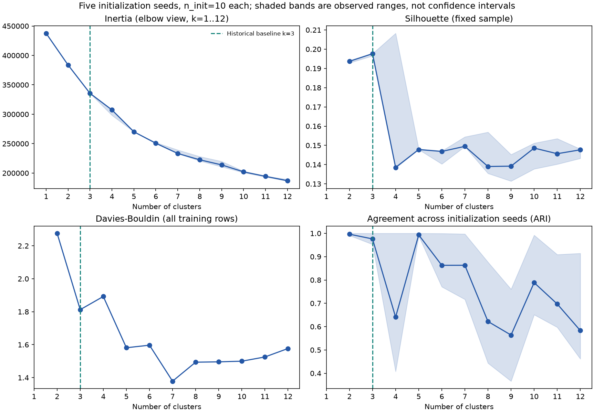
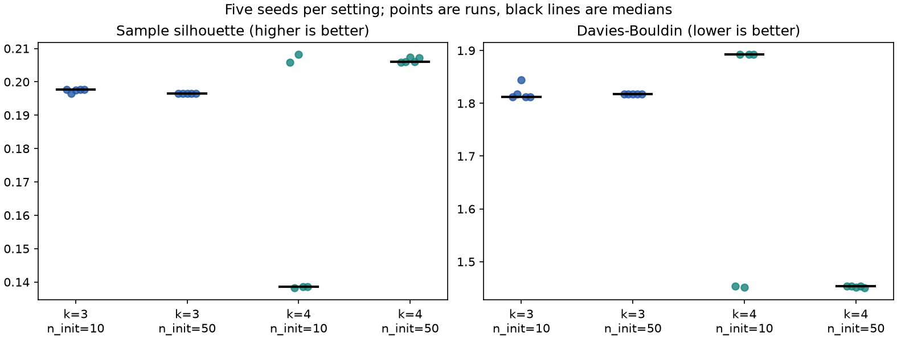
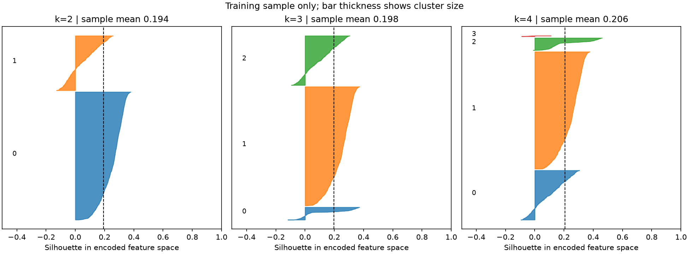

# Clustering pre-push audit — 31 October 2026

The implemented workflow is a reproducible, outcome-free **Milestone 1 K-Means
baseline**. It does not establish a uniquely correct cluster count, a proven
elbow at k=3, or the best final clustering algorithm. Keep the original k=3
experiment as an initial reference. Read the evidence below before describing
it as a final segmentation.

The stronger restart check favors **k=4 over k=3** on both internal metrics for
the tested representation. This corrects any interpretation that three was
already shown to be the best count. No other H2 clustering algorithm has yet
been fitted, and the full final selection remains open.

This audit adds evidence alongside the original experiment; it does not replace
its settings, cluster assignments or fitted models. The old scores reproduce.
Fourteen automated tests pass, and `pip check` reports no broken requirements.

## What was checked

| Check | Evidence/result |
|---|---|
| Source | H2 has 79,330 source rows; its SHA-256 matches the committed split metadata. |
| Shared split | Unique source IDs cover the source, partition counts match, no stored input-group crosses partitions, and the assignments-file hash matches metadata. |
| Input integrity | Every selected clustering attribute in processed training records matches its corresponding raw-source value after deterministic feature construction. |
| Preprocessing | Fresh training-only median imputation, log transforms, numeric scaling and one-hot encoding produce 55,930 × 33 finite features. Binary and cyclic features are unscaled. |
| Outcome exclusion | CSV reads use an input whitelist; ADR, IsCanceled and final reservation-status columns are not loaded by the clustering workflows. Tests change outcomes and confirm unchanged features, labels and profiles. |
| Supervised holdout | Neither clustering script opens the supervised test CSV. No fit or count selection uses validation or supervised outcomes. The audit uses training records for all its experiments. |
| Reproduction | Original k=2..6 scores reproduce to numerical tolerance. The reloaded saved k=3 pipeline matches the audit's reference labels on **all** training rows. |
| Execution | The original `cluster.py` completes successfully after the chart/documentation changes. Runtime measurements change on reruns; they are not controlled speed benchmarks. |

The common feature transformer requires extra raw columns that it discards from
the clustering output. Checking row/group integrity does not prove that different
bookings belong to independent people. The shared grouped split is based on
admitted **supervised** inputs, so identical clustering representations can still
appear in different partitions. This validation is descriptive development
evidence, not an independent-customer performance claim.

Historical source-wide diagnostics were viewed during preparation. We therefore
do not claim that the supervised test set was historically pristine. The narrower
claim above concerns what the clustering scripts load and use. Booking-time
availability also remains an assumption because H2 is a historical snapshot.

## Official examples used as method references

These are examples maintained by scikit-learn itself, including its official
GitHub repository. They demonstrate methods on synthetic data or Iris; they are
not evidence for any particular hotel-booking k or parameter setting.

| Method/issue | Official runnable example and GitHub source | How it informs this project |
|---|---|---|
| K-Means count selection | [Silhouette analysis](https://scikit-learn.org/stable/auto_examples/cluster/plot_kmeans_silhouette_analysis.html), [official source](https://github.com/scikit-learn/scikit-learn/blob/main/examples/cluster/plot_kmeans_silhouette_analysis.py) | Compare multiple counts and inspect individual silhouettes and cluster sizes, rather than relying on one average. The audit adds such plots for k=2,3,4 in our encoded feature space. |
| K-Means assumptions | [Failure/assumption examples](https://scikit-learn.org/stable/auto_examples/cluster/plot_kmeans_assumptions.html), [KMeans API](https://scikit-learn.org/stable/modules/generated/sklearn.cluster.KMeans.html) | Scaling, shape, unequal sizes and initialization matter. Increasing `n_init` addresses local solutions; it does not discover a universal true k. |
| Hierarchical clustering | [Dendrogram example](https://scikit-learn.org/stable/auto_examples/cluster/plot_agglomerative_dendrogram.html), [official source](https://github.com/scikit-learn/scikit-learn/blob/main/examples/cluster/plot_agglomerative_dendrogram.py) | Later: use a recorded, justified subset; fit a hierarchy and display merge distances. No hierarchical H2 model is implemented by this audit. |
| DBSCAN | [DBSCAN example](https://scikit-learn.org/stable/auto_examples/cluster/plot_dbscan.html), [official source](https://github.com/scikit-learn/scikit-learn/blob/main/examples/cluster/plot_dbscan.py) | Later: investigate eps/min_samples and disclose noise membership and coverage. Known toy labels in an example do not permit using cancellation outcomes in our model selection. |
| GMM | [Mixture-model selection](https://scikit-learn.org/stable/auto_examples/mixture/plot_gmm_selection.html), [official source](https://github.com/scikit-learn/scikit-learn/blob/main/examples/mixture/plot_gmm_selection.py) | Later alternative: compare component counts/covariance structures and consider BIC, while discussing whether Gaussian assumptions suit our mixed inputs. No GMM is fitted to H2 here. |
| Algorithm comparison | [Official comparison](https://scikit-learn.org/stable/auto_examples/cluster/plot_cluster_comparison.html) | Different data geometries suit different methods. The four suggested algorithms are distinct methods; five K-Means counts do not count as five algorithms. |

These links were checked on 31 October 2026; `stable` documentation and GitHub
`main` can subsequently change. The audit records the actual local package
versions in its JSON. The new code uses scikit-learn's diagnostic approach and
public APIs; it does not copy a hotel notebook or import its selected k.

## Exact audit experiments

Run `python prepare.py`, then `python cluster.py`, then
`python audit_clustering.py` in the pinned environment. See the root README for
PowerShell setup commands. The audit's default protocol is:

1. Keep the original training records and fit one fresh clustering preprocessor
   on them. Do not refit it on validation or on the supervised test set.
2. Fit k=1..12 for initialization seeds 42,7,21,84,123. For each fit use
   `init='k-means++', n_init=10, max_iter=300, tol=1e-4, algorithm='lloyd'`.
   k=1 supplies the beginning of the inertia curve; silhouette and DB are
   undefined there and are left blank.
3. Score all k>=2 fits using one shared seeded 3,000-row uniform silhouette
   sample (seed 42); compute Davies–Bouldin on all training rows in all 33
   features. Save every count, seed, score, size, inertia and fitting time.
4. For the seed-42 fits, repeat silhouette with sampling seeds 43 and 44.
   These overlapping samples give a sensitivity check, not independent
   confidence intervals or exact full-data silhouettes.
5. Compare cluster assignments across initialization seeds using adjusted Rand
   index (ARI). Here both inputs to ARI are **cluster labels**, never cancellation
   targets. ARI=1 means identical grouping up to arbitrary label names.
   [Official ARI definition](https://scikit-learn.org/stable/modules/generated/sklearn.metrics.adjusted_rand_score.html).
6. Calculate a clearly labelled visual elbow aid for ranges 1..6, 1..8, 1..10
   and 1..12: normalize both axes to [0,1] and find the largest vertical gap
   below the endpoint chord. This simple, range-dependent heuristic is **not**
   Kneedle and does not certify a true count. For the general elbow idea, see
   [Yellowbrick's official explanation](https://www.scikit-yb.org/en/latest/api/cluster/elbow.html).
7. Because k=4 has competing solutions at n_init=10, make a targeted comparison
   of n_init=10 versus 50 for k=3/4 across the same five fit seeds. K-Means
   retains the restart with the lowest inertia, not the highest silhouette.
   [Official n_init behavior](https://scikit-learn.org/stable/modules/generated/sklearn.cluster.KMeans.html).
8. For k=3/4, refit preprocessing and centres on each of three seeded 80%
   training subsets (44,744 bookings, seeds 101,102,103), with n_init=10. Assign
   all training records and compare with the corresponding full-training,
   seed-42 reference. This checks sensitivity to those particular perturbations;
   it is not an unseen-data evaluation or a complete stability study.
9. Inspect the original k=4 profiles in natural units, including babies and
   extreme counts. Plot per-booking sample silhouettes for k=2,3,4.

## What the original k=3 choice actually means

The original experiment used a declared broad-segment preference: every group
should contain at least 1% of the training bookings, then choose the largest
sample silhouette. Exact ties use lower DB and then lower k. This rule picked
k=3. **The 1% threshold is our pragmatic preference, not a requirement in the
assignment or an official scikit-learn rule.**

For the original seed-42 run:

| k | Sample silhouette ↑ | Davies–Bouldin ↓ | Smallest group |
|---:|---:|---:|---:|
| 2 | 0.19368 | 2.27563 | 30.69% |
| 3 | 0.19766 | 1.81254 | 6.41% |
| 4 | **0.20580** | **1.45369** | 0.477% (267 bookings) |

Thus k=3 did **not** win both metrics outright. A claim that it did would be
incorrect. These scores describe our chosen encoded geometry. They are not
accuracy percentages, customer truth or profitability measures.

## The elbow is ambiguous

| Range given to the same chord heuristic | Count it suggests |
|---|---:|
| 1..6 | 3 |
| 1..8 | 5 |
| 1..10 | 5 |
| 1..12 | 5 |

The inertia curve bends gradually rather than uniquely identifying three
segments. More centres reduce squared-distance error; this does not mean that
the largest tested k is best. The hint at five also does not override the other
evidence: k=5's median sampled silhouette is only 0.14784 in this experiment.
Do not draw a line at k=3 and call that line proof of the elbow.

## Initialization, sampling and small-segment findings

With n_init=10, k=3's median silhouette across the five seeds is 0.19766 (range
0.19652–0.19766), while k=4's median is 0.13853 (range 0.13821–0.20825).
k=3's pairwise initialization ARI is 0.95274–1.0; k=4's is 0.40756–1.0.
The old size-aware rule selects three for all five seeds; without that guard,
three seeds prefer k=3 and two prefer k=4. This is a result **for n_init=10**,
not proof that well-optimized four-cluster models are unsuitable.

Increasing n_init to 50 resolves much of that optimization issue:

| k, n_init | Median sample silhouette | Observed silhouette range | Approximate DB range |
|---|---:|---:|---:|
| 3, 50 | 0.19652 | 0.19652–0.19652 | 1.81763–1.81796 |
| 4, 50 | **0.20609** | **0.20580–0.20734** | **1.45019–1.45369** |

Every tested k=4/n_init=50 run beats every tested k=3/n_init=50 run on both
metrics. That is evidence favoring four **in this targeted comparison**, not a
claim about all possible counts, feature definitions, methods or operational
decisions. It would be misleading to cite only the n_init=10 stability result
to dismiss k=4. More restarts select a lower-inertia solution; they need not
increase silhouette, as the small k=3 score change illustrates.

For the seed-42 fits, the three silhouette sample scores are:

| k | Sample seed 42 | Sample seed 43 | Sample seed 44 |
|---:|---:|---:|---:|
| 2 | 0.19368 | 0.17214 | 0.17458 |
| 3 | 0.19766 | 0.19551 | 0.19291 |
| 4 | 0.20580 | 0.20005 | 0.19720 |

The k=3 subset-refit ARIs range from 0.95675 to 0.99525; k=4 ranges from
0.97590 to 0.98355. Three subsets do not prove that either model will be stable
on other datasets or through time.

The original k=4 solution's small group contains **all 267 training bookings
with Babies>0**; its other groups have no recorded babies. There are 260 with
one baby, five with two, one with nine and one with ten. The two extreme counts
deserve review, but it would be wrong to dismiss every booking in the group as
an outlier or a mistake. Standardizing a rare count gives its nonzero values
large distances; feature design helps explain why this group appears.

This group could motivate checking demand for cots or baby amenities. However,
the direct rule `Babies > 0` already identifies it in the observed training
data. Clustering must demonstrate added practical value over such simple rules.
There is no measured operational benefit yet.

In the 3,000-row silhouette picture, the small k=4 group contains just 11 sampled
bookings and 10 have negative silhouettes. Its average is about -0.038. This
illustrates why an improved overall mean does not imply every group is well
separated. The small sample is limited evidence about that group.

## Decision and remaining work

Keep k=3 as the initial Milestone 1 reference, because the assignment requires
an initial baseline rather than a pre-proven optimum. Describe it as a
**preliminary broad segmentation under the documented size preference**, not
the uniquely correct natural count or a proven elbow. Record k=4/n_init=50
as the stronger current comparator on these two internal metrics. If the aim
is simply to choose between these two settings by internal scores, four wins;
if broad groups are explicitly required, the size preference must be stated
as a practical constraint. Do not invent that requirement after seeing the
results or call small groups invalid. Revisit the preference when the intended
hotel decision is clearer. The historical k=3 outputs are retained rather
than silently relabelled as results from a different experiment.

Milestone 1 asks for at least one initial clustering algorithm, preliminary
metrics, interpretation, justified features/preprocessing and leakage awareness.
Those parts are present. The team submission requirements are tracked separately.

The **full Task C** remains later work: at least three distinct algorithms, each
baseline versus systematically optimized settings; full-H2 K-Means where
practical; justified hierarchical sampling and a dendrogram if that method is
selected; further feature/weighting comparisons and useful segment interpretation.
The new audit is extra development evidence, not completion of all those items.
Keep full-H2 unsupervised work separate from supervised test-driven decisions.

## Files and Git review

- `audit_clustering.py`: small command entry point.
- `hotel_booking/clustering_audit.py`: source/split checks, extended fits,
  repeated samples, initialization and subset checks, plots and saved evidence.
- `tests/test_clustering_audit.py`: elbow arithmetic and split-corruption checks.
- `hotel_booking/clustering.py`: original baseline, with a chart-color fix so
  profile colors follow the cluster labels even if more than three are selected;
  generated reporting now points to this audit.
- `outputs/clustering/audit/`: CSV tables, figures and machine-readable summary.
- `outputs/clustering/milestone1/`: original baseline results, regenerated with
  the same scientific settings and an audit link in the report.

See the Milestone 1 report for the contribution and assistance record.
